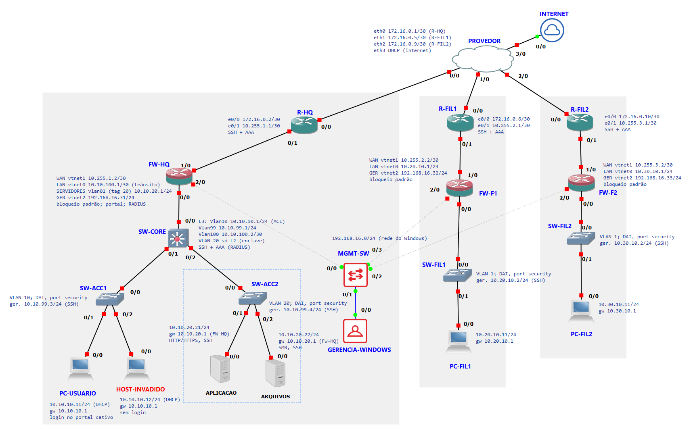

# Zero Trust em rede corporativa: scripts e dados

Scripts e dados do Trabalho de Conclusão de Curso (TCC) de Engenharia Elétrica do Centro Universitário IESB, 2026:

> **Zero Trust em rede corporativa: ganho de segurança versus impacto no desempenho**
> Hélio Andrade da Silva Júnior. Orientador: Prof. Odilon Francisco Pavón Duarte.

O trabalho mediu, em um laboratório emulado no GNS3, o ganho de segurança e o custo de desempenho de controles
Zero Trust em uma rede corporativa com matriz e duas filiais (equipamentos Cisco IOL e firewalls OPNsense 26.7),
implantada em quatro etapas na mesma topologia:

| Etapa | Modelo | Controles |
|---|---|---|
| 0 | Rede plana | Uma sub-rede por unidade; firewalls liberam todo o tráfego; gerência dos Cisco por Telnet |
| A | Perimetral | VLANs de usuários, servidores e gerência roteadas sem restrição pelo switch de núcleo; firewalls filtram só a WAN |
| B1 | Zero Trust | Servidores em enclave atrás do firewall da matriz; bloqueio padrão; portal cativo com RADIUS; ACLs; DAI e port security; gerência por SSH com AAA |
| B2 | Zero Trust com criptografia | B1 mais túneis IPsec (IKEv2) em estrela entre os firewalls |



*Topologia da etapa B1 (Zero Trust) no GNS3, com os endereços e os controles de cada equipamento. As outras etapas
usam a mesma topologia; muda a configuração (na B2, há ainda três PCs com navegador, desligados nas medições).*

Este repositório tem **os scripts** que montaram as etapas, executaram os ensaios e analisaram os resultados,
**os dados** obtidos e **os projetos do GNS3** de cada etapa: a topologia e as configurações dos equipamentos aqui,
e os projetos portáteis completos como anexos da release. Não inclui as imagens dos equipamentos.

## Estrutura

```
scripts/            scripts Python (a mesma versão que gerou os dados)
dados/ensaios/      desempenho: uma pasta por bateria, com os dados brutos de cada repetição
dados/seguranca/    segurança: varreduras do Nmap e vulnerabilidades, por etapa
dados/analise/      estatística: resumo de cada bateria, comparações entre etapas e conferência com o SciPy
gns3/etapa-*/       topologia do GNS3 (.gns3) e configuração de cada equipamento ao fim da montagem
imagens/            Dockerfiles dos contêineres do laboratório (host, servidor e provedor)
```

Anexos da release (fora do Git, pelo tamanho): `TCC-etapa-0.gns3project`, `TCC-etapa-A.gns3project`,
`TCC-etapa-B1.gns3project` e `TCC-etapa-B2.gns3project`, projetos portáteis do GNS3 exportados sem as imagens.

## Reproduzir a análise estatística

Só a análise pode ser refeita sem o laboratório: ela parte dos dados brutos de `dados/ensaios`.

```
python scripts/analisar.py                       # resumo de cada bateria (média, desvio, p95, IC 95%)
python scripts/analisar.py --comparar 0 A        # teste de Welch com ajuste de Holm: etapa A em relação à 0
python scripts/conferir_scipy.py                 # refaz todos os testes com o SciPy e compara
```

As comparações publicadas em `dados/analise` são estas nove:

```
0-rodada1 x 0    0 x 0-verificacao    0 x A    0 x B1    0 x B2
A x B1           B1 x B2              B1 x B2-teste      B2-teste x B2
```

- O `analisar.py` usa só a biblioteca padrão do Python (3.14): t de Welch com graus de liberdade de
  Welch-Satterthwaite, p bicaudal pela função beta incompleta regularizada, ajuste de Holm e IC 95% pela t de Student.
- O `conferir_scipy.py` refaz os 3.204 testes com `scipy.stats.ttest_ind(equal_var=False)`. A decisão (significativa
  ou não, a 5%, após o ajuste de Holm) é a mesma em todos, e os valores p coincidem até cerca de 2 × 10⁻¹².
- Rodar os comandos acima nesta pasta gera de novo, com o mesmo conteúdo, os arquivos de `dados/analise`.

Instalação das bibliotecas (o SciPy só é necessário para a conferência; o paramiko, para o laboratório):

```
python -m pip install -r scripts/requirements.txt
```

Nos comentários dos scripts, os caminhos aparecem como `lab/scripts` e `lab/dados`, a estrutura original do
trabalho. Aqui eles são `scripts` e `dados`, e os scripts funcionam sem alteração, porque procuram `dados` na pasta
acima da sua.

## Dados

### Desempenho (`dados/ensaios`)

Em cada bateria, 30 repetições, após uma de aquecimento descartada, de cada teste em quatro caminhos: rede local da
matriz (`LAN-matriz`), matriz para filial 1 (20 Mbit/s, RTT de 20 ms), matriz para filial 2 (10 Mbit/s, 60 ms) e
filial 1 para filial 2.

| Pasta | O que é |
|---|---|
| `etapa-0`, `etapa-A`, `etapa-B1`, `etapa-B2` | baterias oficiais das quatro etapas |
| `etapa-0-rodada1` | primeira rodada da etapa 0, mantida para medir a variação entre rodadas |
| `etapa-0-verificacao` | 5 repetições da etapa 0 depois da troca dos servidores e da gerência por Telnet |
| `etapa-B2-teste` | rodada adicional completa da B2 (30 repetições, sem aquecimento), de reprodutibilidade |
| `etapa-B2-com-falha-SW-ACC1` | bateria da B2 em que o switch de acesso da matriz travou (falha do emulador no *port security*); as repetições afetadas foram refeitas na `etapa-B2` |

Arquivos de cada bateria:

| Arquivo | Conteúdo |
|---|---|
| `resultados.csv` | uma linha por repetição, caminho, teste e tamanho de pacote: vazão, retransmissões, jitter, perda, RTT médio, p95, mínimo e máximo |
| `cpu.csv` | CPU (% de um núcleo) e memória de cada equipamento durante cada teste |
| `ambiente.csv` | carga da GNS3 VM e do computador hospedeiro durante cada teste |
| `bruto.jsonl` | saída original do fping e JSON completo do iperf3 de cada teste |
| `meta.json` | caminhos, tamanhos de pacote, equipamentos e comandos usados |
| `portal.csv` | (B1 e B2) 30 autenticações no portal cativo: redirecionamento sem sessão, recusa da senha errada, tempo de login e do primeiro acesso |

Os comandos: latência com `fping -C 20 -p 100 -t 1000`; TCP com `iperf3 -t 10`; UDP com `iperf3 -u` por 5 s a 90% da
capacidade do caminho, com pacotes de 64, 512, 1024 e 1400 bytes; CPU pela variação de `utime + stime` dos processos
QEMU e IOL e pelo `cpuacct` dos contêineres. Os arquivos `.log` são o registro de execução de cada bateria.

### Segurança (`dados/seguranca`)

Por etapa, a partir de dois hosts considerados comprometidos (`HOST-INVADIDO`, na matriz, e `PC-FIL1`):

| Arquivo | Conteúdo |
|---|---|
| `*_descoberta.xml`, `*_servicos.xml` | saída XML do Nmap: descoberta sem ARP e varredura SYN com detecção de versão nas 1000 portas TCP mais comuns |
| `alcance.csv` | equipamentos alcançáveis a partir de cada origem |
| `servicos.csv` | serviços expostos, com produto, versão e CPE |
| `vulnerabilidades.csv` | CVEs associadas a cada CPE, com CVSS |
| `resumo.json`, `resumo.md` | contagens por etapa e origem |
| `vulners_cache.json` | respostas da API pública do vulners.com usadas na consulta das CVEs |

### Estatística (`dados/analise`)

- `etapa-*_desempenho.csv` e `etapa-*_cpu.csv`: n, média, desvio-padrão, p95 e meia largura do IC 95% de cada métrica.
- `comparacao_*.csv`: para cada uma das 356 métricas do par de etapas, a diferença, o IC 95% da diferença, t, graus
  de liberdade, p, p ajustado por Holm e a decisão a 5%.
- `conferencia_scipy.csv` e `.md`: resultado da conferência independente com o SciPy.
- Os `.md` trazem as mesmas tabelas em formato legível.

## Reproduzir o laboratório

O laboratório usa o GNS3 2.2.61 com a GNS3 VM. Os equipamentos vêm destas imagens:

| Template do GNS3 | Uso | Imagem |
|---|---|---|
| `TCC - IOL L3 15.4` | roteadores | `x86_64_crb_linux-adventerprisek9-ms.iol` (Cisco; proprietária, não distribuída) |
| `TCC - IOL L2 17.15` | switches | `x86_64_crb_linux_l2-adventerprisek9-ms.iol` (Cisco; proprietária, não distribuída) |
| `TCC - OPNsense 26.7` | firewalls | `OPNsense-26.7-nano-amd64.img` (disponível no site do OPNsense) |
| `TCC - Host` | computadores | `tcc-host:2` (`imagens/host`: Alpine com fping, iperf3 e Nmap) |
| `TCC - Servidor` | servidores de aplicação e de arquivos | `tcc-servidor:1` (`imagens/servidor`: OpenSSH, lighttpd e Samba) |
| `TCC - Provedor` | provedor da WAN, com atraso e limite de banda emulados | `tcc-provedor:1` (`imagens/provedor`) |
| `TCC - Navegador` | PCs com navegador, só no projeto da B2 | `gns3/webterm:latest` (Docker Hub) |

As imagens dos contêineres são geradas na GNS3 VM com `docker build -t tcc-host:2 imagens/host` (e, do mesmo modo,
`tcc-provedor:1` e `tcc-servidor:1`, este depois do `tcc-host:2`).

### Opção 1: abrir os projetos prontos

Com as imagens instaladas, importe no GNS3 (*File → Import portable project*) o `.gns3project` da etapa, anexado à
release. Cada projeto traz os discos dos equipamentos já configurados. No projeto da B2, os três PCs com navegador
(`PC-NAV-*`) ficaram desligados durante as medições.

### Opção 2: montar com os scripts

Os scripts falam com o controlador do GNS3 e com a GNS3 VM (endereço na variável `GNS3_VM_HOST`; padrão
`192.168.16.130`) e criam os equipamentos a partir dos templates acima. Ordem de execução:

1. `montar_etapa0.py`, `servidores_etapa0.py` e `gerencia_telnet_etapa0.py`: etapa 0 (`TCC-etapa-0`).
2. Duplicar o projeto no GNS3 e rodar `montar_etapaA.py` (A), depois `montar_etapaB1.py` (B1), cada um sobre a
   cópia da etapa anterior.
3. B2: `navegadores_b1.py` faz a cópia da B1 com os PCs de navegador (`TCC-etapa-B1-navegador`), que foi duplicada
   para a B2, e `montar_etapaB2.py` configura o IPsec.
4. Em cada etapa: `ensaio.py --projeto TCC-etapa-X --etapa X --reps 30` (desempenho),
   `seguranca.py --projeto TCC-etapa-X --etapa X` (segurança) e, nas etapas B, `medir_portal.py` (autenticação).
5. `analisar.py` e `conferir_scipy.py` (estatística).

`gns3lab.py` reúne as funções comuns; `rotulos_etapas.py` e `rotulos_ip.py` só escrevem anotações no desenho do
GNS3, para as figuras. Em `gns3/etapa-*/configuracoes` estão a configuração final de cada equipamento (`.cfg` dos
Cisco, `config.xml` dos OPNsense, `provedor.sh`), o registro da montagem e o teste funcional da etapa.

**Senhas e chaves:** os scripts, as configurações e os projetos trazem as senhas e as chaves do laboratório
(equipamentos, portal, RADIUS, chaves da API dos OPNsense, chaves pré-compartilhadas do IPsec e certificados). Elas
valem apenas dentro da rede emulada e isolada do GNS3 e foram mantidas para que os arquivos sejam os mesmos que
geraram os dados.

## Alterações em relação aos arquivos originais

- Nos arquivos `.log`, o caminho absoluto da pasta do trabalho no computador do autor foi removido; os caminhos ficaram
  relativos à raiz do repositório.
- `dados/analise` foi gerada de novo pelos scripts desta pasta. O conteúdo é o mesmo da análise original, com o
  resumo da bateria `etapa-B2-com-falha-SW-ACC1` a mais.

## Licença

Código e configurações (`scripts/`, `gns3/`, `imagens/`): licença MIT (arquivo `LICENSE`). Dados (`dados/`):
[Creative Commons Atribuição 4.0 Internacional (CC BY 4.0)](https://creativecommons.org/licenses/by/4.0/deed.pt-br).

## Como citar

Veja `CITATION.cff`, ou cite o artigo e este repositório:

> H. A. da Silva Júnior, *Zero Trust em rede corporativa: scripts e dados*, versão 1.0, 2026. [Online].
> Disponível: https://github.com/helio-andrade/iesb-ee-tcc
